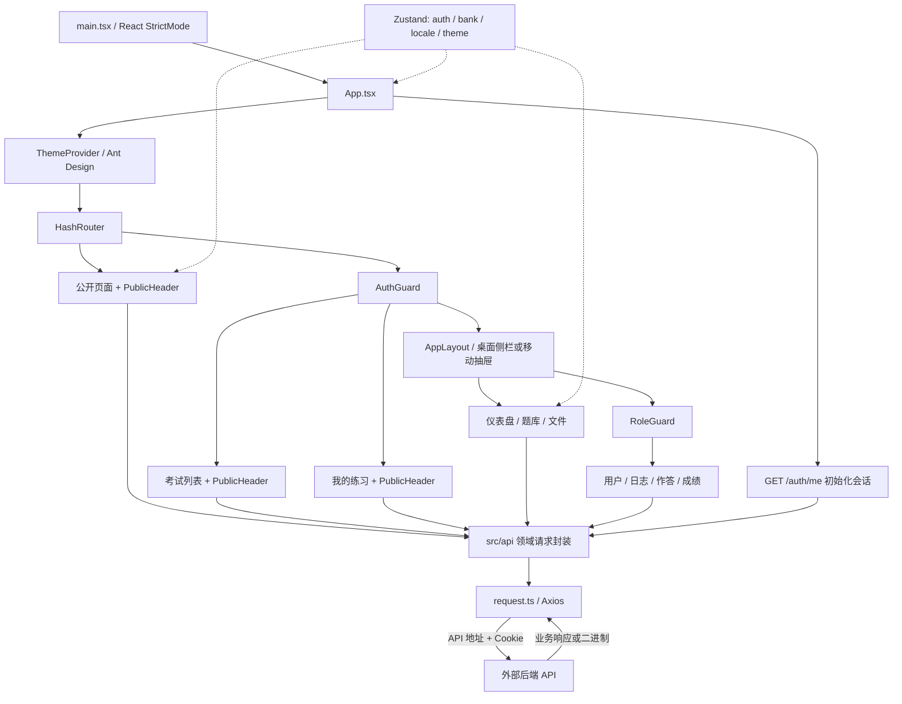
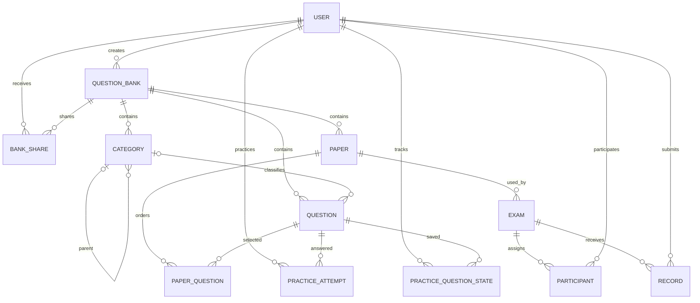

# 系统架构

[文档索引](README.md)

## 应用组成

本仓库是浏览器端单页应用. 页面通过 `src/api/` 访问外部后端, 不直接连接数据库、对象存储或 AI 服务.

依据: [入口](../src/main.tsx), [App](../src/App.tsx), [路由](../src/router/index.tsx), [请求实例](../src/api/request.ts). 完整访问条件见 [路由与权限](permissions.md).

## 服务器部署

[Dockerfile](../Dockerfile) 在 Node 构建阶段生成 `dist/`, 最终镜像仅由 Nginx 提供静态文件并代理 `/api/`. [Compose](../compose.yaml) 将前端 `web` 加入已有后端 Docker 网络, 默认通过 `app:3000` 访问后端. 浏览器通过已有 HTTPS 入口访问相同域名的页面和 API, 入口转发到前端 HTTP 服务, 默认宿主机地址为 `127.0.0.1:8080`.

后端由独立 Compose 管理, 前端不保存后端密钥或管理数据库迁移. 网络、入口要求和部署结构图见 [Docker + Nginx 部署](docker-deployment.md).

## 目录职责

| 目录或文件 | 职责 |
| --- | --- |
| [src/pages/](../src/pages/) | 页面状态、表单、数据获取和用户操作 |
| [src/components/](../src/components/) | 路由守卫、主题容器、布局、偏好设置、公共题库卡片 |
| [src/router/index.tsx](../src/router/index.tsx) | 公开、登录保护和角色保护路由 |
| [src/api/](../src/api/) | 按领域封装 HTTP 请求, 共享拦截器和文件下载 |
| [src/types/](../src/types/) | 前端请求/响应类型与枚举; 练习类型在 `api/practice.ts` |
| [src/stores/](../src/stores/) | 跨页面状态 |
| [src/hooks/](../src/hooks/) | 分页与响应式断点 |
| [src/utils/](../src/utils/) | 翻页汇总、日期格式化、国际化标签 |
| [src/locales/](../src/locales/) | 语言初始化与中英文资源 |
| [src/styles.css](../src/styles.css) | 全局变量、公共页面、布局和媒体查询 |

`@` 指向 `src/`, 同时配置在 [Vite](../vite.config.ts) 和 [TypeScript](../tsconfig.app.json) 中.

## 状态与数据流

页面通过领域 API 获取数据, 存入组件的 `useState`, 通过 Ant Design 表单提交变更并刷新列表. 当前没有独立的服务端数据缓存层.

| 状态 | 内容 | 持久化与恢复 |
| --- | --- | --- |
| [authStore](../src/stores/authStore.ts) | `user`, `initialized`, 角色判断 | 内存状态; 启动时通过 `/auth/me` 恢复 |
| [bankStore](../src/stores/bankStore.ts) | `currentBank`, 包含题库权限 | localStorage 的 `currentBank` |
| [localeStore](../src/stores/localeStore.ts) | 界面语言 `zh` / `en` | i18next 使用 localStorage 的 `language` |
| [themeStore](../src/stores/themeStore.ts) | `light` / `dark` / `system`, 系统深色状态 | localStorage 的 `theme`, 配合 `matchMedia` |
| 页面内部状态 | 列表、筛选、表单、答题内容、AI 草稿等 | 通常只在当前组件存活期间有效; 考试草稿及登录用户的练习记录、错题和收藏通过接口保存 |

题库详情由 `currentBank` 是否为空决定显示, URL 保持 `/#/question-banks`. 子标签直接渲染 Categories、Questions、Papers、Exams 和 AI 组件, 权限决定可见标签. 当前题库缓存不是权限凭证, 接口访问仍由后端校验.

分页列表复用 [usePagination](../src/hooks/usePagination.ts), 默认每页 20 条. 下拉选择、仪表盘和考试分组使用 [getAllPages](../src/utils/pagination.ts), 每批请求 100 条, 累计达到 `total` 或遇到空页时结束.

## 业务对象关系

下图依据前端类型中的关联字段绘制, 用于理解页面数据关系, 不代表数据库完整 schema 或服务端约束.

- `QUESTION_BANK` 的 `isPublic` 控制公开练习入口; `permission` 描述当前访问者的题库权限.
- `PAPER_QUESTION` 保存 `questionId`、`sortOrder` 和题目对象.
- 考试通过 `paperId` 关联试卷, 前端创建考试请求不包含 `bankId`.
- `PARTICIPANT` 对应考试响应的 `participants`; 表单通过 `studentIds` 提交分配名单.
- `RECORD` 包含 `draft` / `submitted` 状态、答案和分数. 页面展示服务端结果, 不在前端判分.
- 个人练习通过 `api/practice.ts` 查询提交记录和题目状态, 收藏/错题列表不读取答案; 记录接口返回本人已提交的答案和参考答案/解析快照. 正确率仅使用服务端统计的已判分记录.

依据: [题库类型](../src/types/question-bank.ts), [分类类型](../src/types/category.ts), [题目类型](../src/types/question.ts), [试卷类型](../src/types/paper.ts), [考试类型](../src/types/exam.ts), [记录类型](../src/types/record.ts).

## 样式、响应式与国际化

[ThemeProvider](../src/components/ThemeProvider.tsx) 同时设置 Ant Design 语言、配色算法和组件 Token. [App](../src/App.tsx) 同步系统主题变化, 将最终主题写到根元素的 `data-theme`, 并为静态消息组件配置同一主题容器. [styles.css](../src/styles.css) 提供对应 CSS 变量; 页面仍保留局部内联样式.

[useBreakpoint](../src/hooks/useBreakpoint.ts) 将低于 576px 的布局归为 `isMobile`. 管理列表通常切换为卡片, AppLayout 切换为抽屉. 全局 CSS 另有 900px 和 575px 媒体查询, 负责公共页布局和细节样式.

[语言初始化](../src/locales/index.ts) 按 localStorage、浏览器语言的顺序检测, 支持 `zh` / `en`, 回退到中文. 语言变化同步 Ant Design、dayjs、文档语言和页面标题. 题目内容语言是独立业务字段, 练习页优先使用个人选择或界面语言, 无对应翻译时回退到题目主语言.
