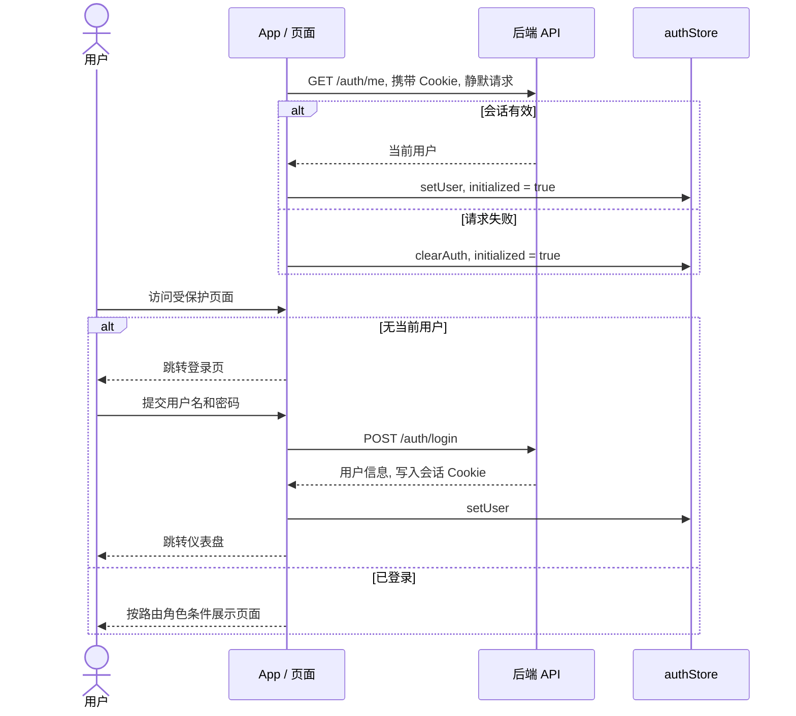
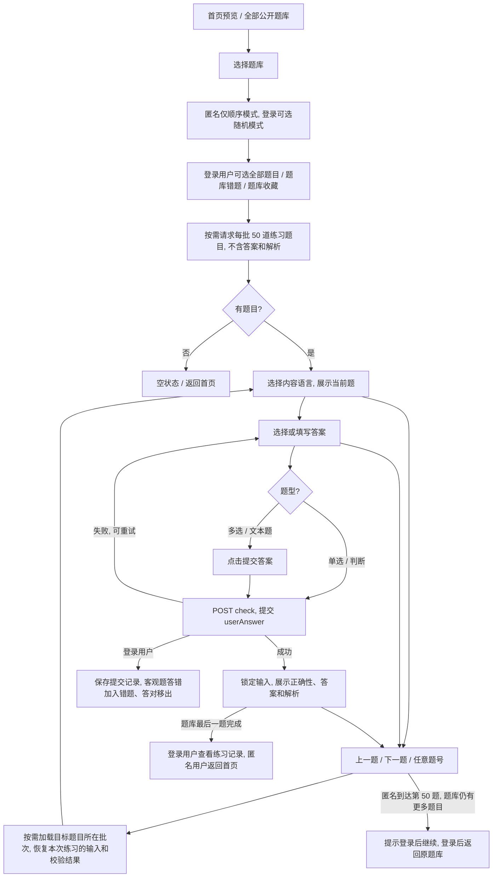
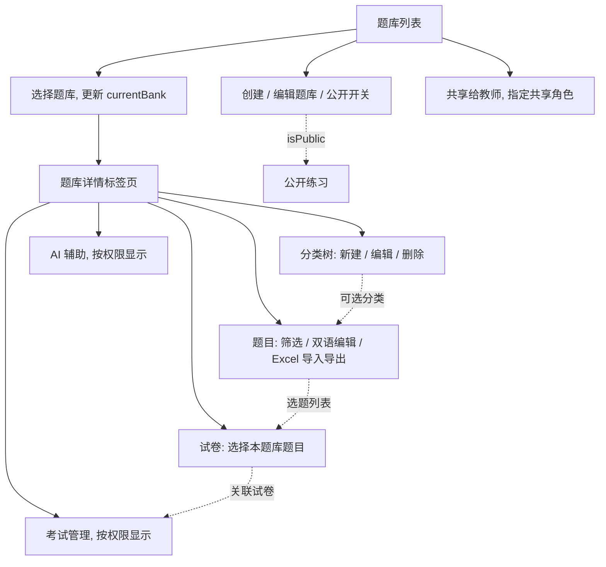
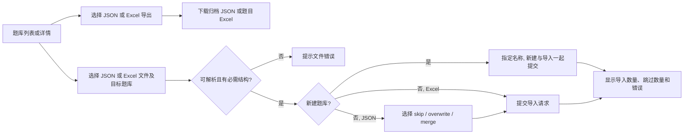
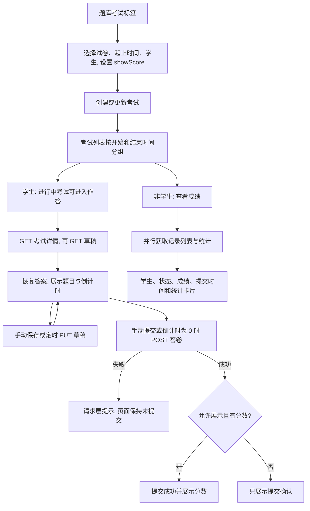
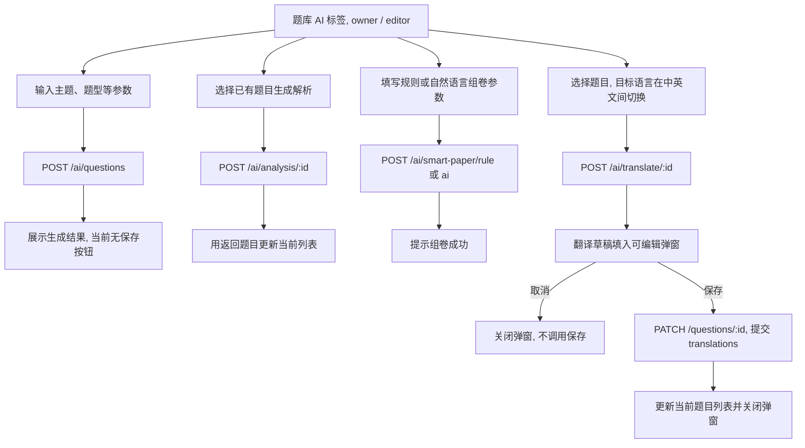

# 现有业务流程

[文档索引](README.md)

流程图描述前端当前的调用和页面行为. 路由及按钮条件见 [路由与权限](permissions.md), 请求字段见 [前端 API](frontend-api-doc.md).

## 登录与会话恢复

- 登录页使用响应中的 `user`, 不把 `access_token` 写入 localStorage. 从练习提示进入登录页时, 成功后返回原题库的模式选择页; 其他入口成功后前往 `/dashboard`.
- 退出调用 `POST /auth/logout`, 无论请求成功与否都通过 `finally` 清除内存用户. 请求成功后返回首页; AppLayout 还会清除当前题库, PublicHeader 不清除题库缓存.
- 普通请求 401 与启动时的静默探测有不同处理, 详见 [错误与会话失效](frontend-api-doc.md#错误与会话失效).

依据: [App](../src/App.tsx), [登录页](../src/pages/Login/index.tsx), [PublicHeader](../src/components/Layout/PublicHeader.tsx), [AppLayout](../src/components/Layout/AppLayout.tsx).

## 邀请码注册

超级管理员在用户管理页打开 "注册邀请码", 选择注册账号角色并生成邀请码, 可复制未使用的邀请码, 列表展示使用状态. 登录页提供注册入口, `/register` 与登录页共用布局, 注册表单包含用户名、密码、确认密码和邀请码. 确认密码只用于前端校验, 请求不携带角色, 注册账号角色由后端根据邀请码决定.

注册成功提示用户登录并返回登录页, 自动填入用户名. 登录和注册切换会保留原练习题库的返回信息, 登录成功后回到原练习入口. 注册失败保留表单供修正, 重复用户名不会消耗邀请码. 见 [登录和注册页](../src/pages/Login/index.tsx), [邀请码管理](../src/pages/Users/RegistrationInvites.tsx).

## 公开练习

首页展示公开题库列表的前 4 项, `/practice` 展示全部列表. 会话初始化后展示练习入口. 未登录仅可顺序练习前 50 题, 随机模式禁用, 页面提示登录后解锁. 导航依据后端 `practiceTotal` 限制题号和分页; 题库超过 50 题时, 第 50 题的下一步显示为登录后继续, 登录成功返回原题库的模式选择页. 题库不超过 50 题时可匿名完成全部题目. 登录用户提交答案会保存练习记录并更新错题状态, 匿名提交不保存个人数据.

顺序/随机模式作为 `mode` 传给后端, 首次只加载 50 道题. 后续导航翻页及跨批切题时按需加载, 已加载的批次缓存在本次页面内存中. 后续请求复用首次返回的排序种子, 随机模式翻页和搜索保持同一顺序. 无论题目顺序模式如何, 单选和多选的选项都会在首次加载该题时打乱一次, 按显示位置重新编号为 A/B/C/D 等字母. 切题返回、搜索、重复加载批次或切换语言保持同一选项顺序和编号. 提交仍使用原有选项键, 多选按原有键排序后用逗号连接; 返回的正确答案与解析中的选项引用按同一映射转换为当前显示编号. 判断题使用字符串 `true` / `false`; 填空、简答和编程题使用文本输入.

单选和判断题点击选项立即提交, 不显示单独的提交按钮; 多选及文本题填写后点击提交答案. 判题期间锁定当前题目的输入和切题操作, 失败后可重试. 上一题和下一题不要求已提交, 在首尾题、请求处理中或练习集合待刷新时禁用相应操作. 题号导航每页展示 50 个题号, 支持翻页及点击题号跳转. 翻页只切换题号列表; 点击题号、上一题或下一题时, 导航同步到当前题目所在页. 答案、判题状态和结果按题目保存于当前页面内存, 切题后返回可继续作答或查看结果.

简答与编程题不自动判分, 提交后提示自行对照参考答案, 不将其视为答错或纳入客观题正确率. 登录用户可在题目标题旁收藏或取消收藏. 题库错题练习中答对, 或题库收藏练习中取消收藏后, 页面保留当前结果并暂时锁定旧题号导航; 点击继续复习会重新读取最新集合、清除原分页和作答缓存, 防止集合变化造成题号错位.

桌面布局将题目放在左侧, 题号导航放在右侧并随页面滚动保持可见; 移动端将导航放在题目上方. 题号列表支持独立滚动.

题干附图显示在选项上方, 选项附图跟随原始选项键显示, 切换语言或打乱选项不改变图片归属. 图片可点击放大, 不触发选项提交. 预签名链接过期导致加载失败时自动换取新链接, 更新图片信息并保留练习状态; 加载失败可点击重新加载.

导航搜索框在输入停止 300 毫秒后请求后端检索当前可练习范围, 匿名时限前 50 题, 登录后包括整个题库中尚未加载的题目, 匹配题干、选项及翻译内容, 忽略关键词首尾空格和英文大小写. 搜索结果显示匹配数量、原题号和题干摘要, 每页最多 50 条, 点击结果跳转到原题. 修改关键词后回到搜索结果第一页; 清空关键词后恢复可练习题号并定位当前题目所在页. 过期搜索响应不会覆盖新关键词的结果. 搜索和翻页不清除答案或判题结果, 上一题和下一题仍按可练习题目的顺序切换. 加载失败可重试, 切题请求失败时保留当前题.

题目语言优先使用用户在练习页选择的语言, 否则使用界面语言; 没有对应翻译时回退主语言. 切换只影响标题和选项文本, 校验请求不携带语言参数; 答案与解析沿用校验接口的语言, 选择题中的选项编号转换为当前显示编号.

依据: [首页](../src/pages/Home/index.tsx), [题库列表](../src/pages/PracticeList/index.tsx), [练习页](../src/pages/Practice/index.tsx), [练习接口](../src/api/practice.ts).

## 我的练习

登录用户从公共页导航或管理侧栏进入 `/practice/mine`, 在我的错题、我的收藏和练习记录标签间切换. 页面显示当前公开题库中的错题数量、收藏数量、累计作答和客观题正确率, 支持按题库筛选和分页. 空列表提供练习入口, 查询失败提供重试.

错题与收藏列表可直接再次练习、收藏/取消收藏, 错题还可手动移出错题本. 再次练习通过 `questionId` 定位到题库练习页中的对应题目, 不依赖当前题是否位于第一页. 复习该题库通过 `collection` 选择该题库的错题或收藏范围. 练习记录按提交显示正确、错误或未自动判分, 可展开回看本人答案以及提交时参考答案和解析. 题库不再公开时相关内容不出现在个人列表或统计中.

依据: [我的练习页](../src/pages/MyPractice/index.tsx), [练习页](../src/pages/Practice/index.tsx), [练习接口](../src/api/practice.ts).

## 题库协作与内容管理

图中的写操作需满足 [题库权限矩阵](permissions.md#题库权限), 不是进入详情即可使用全部功能.

分类页同时加载平面列表和树. 创建分类时携带 `bankId`, 可指定父分类; 编辑父分类选项时排除自身及其后代.

题目支持单选、多选、判断、填空、简答和编程 6 种类型. 表单固定保留中英文栏, 由主语言决定顶层的标题、选项、答案和解析, 另一种语言写入 `translations`. 列表提供关键词、题型和难度筛选, 改变筛选后回到第一页. Excel 导入显示成功/失败数量和行错误, 再刷新列表; 导出请求默认携带当前题库 ID.

手动组卷通过 `getAllPages` 加载当前题库题目, 用 Transfer 选择题目 ID, 连同名称、时长和总分提交. 编辑时先读取试卷详情恢复已选题目. 总分最终展示接口返回值, 前端没有重算总分逻辑.

依据: [题库页](../src/pages/QuestionBanks/index.tsx), [分类页](../src/pages/Categories/index.tsx), [题目页](../src/pages/Questions/index.tsx), [试卷页](../src/pages/Papers/index.tsx).

## 题库归档

题库列表顶部提供一键导入, 每行、移动端卡片和题库详情提供一键导入及导出. 导出菜单可选 JSON 或 Excel, 文件名分别为 `<题库名>-archive.json` 和 `<题库名>.xlsx`. JSON 包含题库元信息、分类树和完整双语题目; Excel 包含题目、分类名称、主语言和翻译, 不含分类层级. 两种格式均不包含试卷、考试、成绩、共享名单或题目图片.

导入可选择新建题库或有编辑权限的已有题库. 文件支持 `.json` 和 `.xlsx`, 最大 10 MB. JSON 本地检查元信息、分类和题目数组以及版本 `1`, 其余内容由后端校验. 新题库名称从归档名称或 Excel 文件名填入, 可修改; 新建及导入一起提交, 错误时回滚. Excel 新建题库按分类名称创建平级分类.

JSON 导入已有题库默认使用 `skip`, 选择 `overwrite` 时显示覆盖提示. Excel 导入已有题库显示逐行成功和失败数量及行错误. 导入后立即刷新题库列表和切换列表; 如果导入到当前题库, 重新加载内容标签页. 正在导入时禁止重复提交和关闭弹窗.

依据: [题库归档处理](../src/pages/QuestionBanks/index.tsx), [归档类型](../src/types/question-bank.ts).

## 考试配置、作答与成绩

考试创建需要试卷和时间范围, `studentIds` 从用户列表中筛选学生生成, `showScore` 初始为 `false`. 编辑只更新名称、时间、分配名单和显示分数开关, 不提供换卷入口. 日期通过 `toISOString()` 提交.

考试列表通过 `getAllPages` 获取后端返回的可见考试. 分组规则为: `now < startTime` 是未开始, `now >= endTime` 是已结束, 其余是进行中. 列表每 30 秒更新用于分组的当前时间, 不同时重拉考试数据. 学生未开始的考试按钮禁用, 已结束的不显示作答入口; 非学生显示成绩入口. 被分配学生的访问范围依赖服务端筛选和校验.

作答页按试卷响应顺序展示题目, 草稿与提交都发送 `answers: Record<questionId, string>`. 多选答案排序后用逗号连接. 手动保存与 30 秒定时保存共用同一函数; 答案变化会重建定时器, 因此不是严格固定时刻保存. 前端只提交答案, 具体判分由后端完成.

成绩页并行读取分页记录和统计, 展示人数、最高分、最低分和平均分. 当前没有逐题阅卷、改分或学生个人历史成绩页面.

### 当前实现边界

- 考试管理列表按当前 `bankId` 筛选, 但新建/编辑弹窗加载试卷时调用 `getAllPages(getPapers)`, 没有附带当前题库筛选. 候选范围以接口返回为准.
- 倒计时依据考试 `endTime`, 不按试卷 `duration` 单独计算. 它在加载完成后计算剩余秒数, 再逐秒递减.
- 自动提交 effect 只检查 `timeLeft === 0`、未提交和考试 ID, 没有等待加载完成; `timeLeft` 初始就是 0, 因而加载期间也可能触发提交请求. 图中的顺序表示正常加载后的路径, 不能据此认为已有初始化保护.
- 显示分数的实际表达式是 `exam?.showScore !== false && submittedScore !== null`. 在有效布尔字段下, 关闭开关会隐藏分数; 缺失字段不等同于关闭.

依据: [考试管理](../src/pages/Exams/index.tsx), [考试列表](../src/pages/ExamList/index.tsx), [作答页](../src/pages/ExamTaking/index.tsx), [成绩页](../src/pages/Records/index.tsx).

## AI 辅助

| 操作 | 页面行为 |
| --- | --- |
| 生成题目 | 携带当前 `bankId`, 默认数量 5, 表单范围 1 至 20. 返回结果仅写入本地 `generatedQuestions`, 没有后续 `createQuestion` 入库流程 |
| 生成解析 | 直接调用题目解析接口, 使用返回的完整题目替换本地条目, 没有草稿确认步骤 |
| 规则组卷 | 提交名称、时长、总分、当前 `bankId` 和规则数组; 规则表单包含题型、难度、数量、单题分数 |
| AI 组卷 | 提交名称、时长、总分、主题、难度偏好、可选分类和当前 `bankId`; 成功后只显示提示 |
| AI 翻译 | 主语言为中文则目标为英文, 否则目标为中文. 返回草稿经用户修订后, 仅提交目标语言的 `translations` 块 |

AI 请求使用共享的 30 秒超时, 当前没有单独延长、流式响应或自动重试. 规则/AI 组卷没有生成结果审核页, 也没有在成功后自动跳转或刷新试卷标签.

依据: [AI 页面](../src/pages/AI/index.tsx), [AI 请求](../src/api/ai.ts), [AI 类型](../src/types/ai.ts).

## 仪表盘与系统管理

| 模块 | 当前业务逻辑 | 代码 |
| --- | --- | --- |
| 仪表盘 | 学生查看进行中/未开始/已结束/全部考试数; 非学生查看题库、公开题库和考试数; 两类管理员额外查看用户数. 统计基于接口返回的可见数据, 分组时间固定为挂载时刻 | [Dashboard](../src/pages/Dashboard/index.tsx) |
| 用户管理 | 超级管理员加载用户数组, 创建账号或编辑用户名、角色及可选密码. 编辑时空密码不提交, 删除后刷新 | [Users](../src/pages/Users/index.tsx) |
| 文件管理 | 分页读取文件; 有上传权限时发送 multipart 文件; 下载经共享工具触发浏览器下载; 有删除权限时确认后删除并刷新. 文件选择器限制扩展名/类型, 前端没有 10MB 大小校验 | [Files](../src/pages/Files/index.tsx) |
| 操作日志 | 超级管理员按用户名、操作类型、资源和日期范围查询分页日志, 筛选变化重置页码. 当前只有查询界面 | [Logs](../src/pages/Logs/index.tsx) |

删除操作的引用检查、文件大小上限、成绩统计口径和账号校验由后端执行, 本仓库不定义这些服务端规则.
