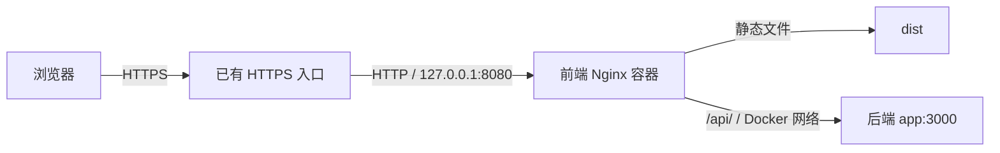

# Docker + Nginx 部署

[文档索引](README.md)

从本仓库根目录执行命令. [Dockerfile](../Dockerfile) 使用与 [.nvmrc](../.nvmrc) 一致的 Node 构建前端, 最终镜像由 Nginx 提供静态文件并代理 `/api/`. [compose.yaml](../compose.yaml) 只管理前端服务 `web`, 后端继续由其自己的 Compose 管理.

本配置用于已有 HTTPS 入口的单台服务器. 前端容器只监听 HTTP, 默认发布到宿主机 `127.0.0.1:8080`. 浏览器通过已有入口的 HTTPS 域名访问, 不直接访问容器端口.

## 部署结构



前端构建时固定 `VITE_API_BASE_URL=/api`, 浏览器页面和 API 使用相同域名. `.env` 和 `.env.*` 不进入构建上下文, 本地开发的 `localhost:3000` 配置不会进入镜像. `VITE_` 变量在构建时写入 JS, 不能通过运行时环境变量修改, 见 [Vite 环境变量说明](https://vite.dev/guide/env-and-mode).

## 部署前准备

安装并启动 Docker Engine 和 Compose 插件, 检查工具可用:

```sh
docker version
docker compose version
```

先按照后端仓库的部署文档完成环境配置、数据库迁移和服务启动. 本仓库不运行后端迁移, 不读取后端密钥.

默认后端配置来自相邻 `exam-platform` 仓库: 服务名 `app`, 容器端口 `3000`, API 前缀 `/api`. 前端加入后端已创建的 `exam-platform_default` 网络. 如果后端使用了自定义 Compose 项目名, 网络名也会变化, 需要覆盖 `BACKEND_NETWORK`. 可查看现有网络, 根据后端 Compose 项目名确认对应的 default 网络:

```sh
docker network ls
```

容器之间使用服务名和容器端口访问, 不使用宿主机映射端口或固定容器 IP. 依据: [Compose 网络说明](https://docs.docker.com/compose/how-tos/networking/).

## 配置

| 变量 | 默认值 | 用途 |
| --- | --- | --- |
| `IMAGE_TAG` | `local` | 前端镜像版本 |
| `FRONTEND_PORT` | `8080` | 宿主机 HTTP 端口, 固定绑定 `127.0.0.1` |
| `BACKEND_NETWORK` | `exam-platform_default` | 后端已存在的 Docker 网络名 |
| `BACKEND_UPSTREAM` | `app:3000` | 后端服务名和容器端口, 不含协议和路径 |

默认值匹配现有后端配置. 需要覆盖时, 将变量写到已被 Git 忽略的 `.env.deploy.local`, 并在所有 Compose 命令中加上 `--env-file .env.deploy.local`:

```dotenv
FRONTEND_PORT=8080
BACKEND_NETWORK=exam-platform_default
BACKEND_UPSTREAM=app:3000
```

```sh
docker compose --env-file .env.deploy.local config --quiet
```

已有 HTTPS 入口需要将此域名的全部路径转发到 `http://127.0.0.1:8080`, 包括静态文件和 `/api/`, 保留请求路径、原始 `Host`, 并设置 `X-Forwarded-Proto: https`. 如果入口也是 Docker 容器, 入口中的 `127.0.0.1` 指向入口自身; 应让它加入相同 Docker 网络, 使用 `http://web:80` 访问前端.

后端生产 Cookie 使用 `Secure`, 浏览器必须通过 HTTPS 访问. 如后端配置了 `CORS_ORIGIN`, 将其设为实际前端 origin, 包含协议, 如 `https://exam.example.com`. 修改后端环境变量后重新创建后端容器.

## 构建和启动

使用 Git commit 标记镜像版本, 在同一个 shell 中执行:

```sh
export IMAGE_TAG="$(git rev-parse --short HEAD)"
docker compose config --quiet
docker compose build web
docker compose up -d --no-build web
docker compose exec web nginx -t
docker compose ps
```

仅通过 Docker 构建和运行时, 宿主机不需要安装 Node 或 pnpm. 构建阶段固定使用 pnpm 10.33.2 和锁文件; 最终镜像不包含 Node、源码或依赖目录. 多阶段构建依据: [Docker 官方文档](https://docs.docker.com/build/building/multi-stage/).

`config --quiet` 检查 Compose 配置, 不验证 Docker 网络是否存在或后端是否可访问. `nginx -t` 检查生成后的 Nginx 配置, 不代表后端业务正常.

通过实际 HTTPS 域名验证页面、登录、刷新后的会话恢复、文件上传和答题提交. 宿主机 HTTP 地址可用于检查静态文件和代理连通性, 不用于验证生产 Cookie 登录.

## 更新和回滚

更新代码后, 使用新的 `IMAGE_TAG` 重复构建和启动命令. 如果在 CI 构建, 将带版本标签的镜像推到自己的镜像仓库, 并同步调整 Compose 的 `image` 地址; 服务器拉取该版本后使用 `up -d --no-build web` 启动.

保留旧镜像和当时的部署变量. 回滚时将 `IMAGE_TAG` 设为实际保留的旧版本, 再执行:

```sh
docker compose up -d --no-build web
```

回滚前端镜像不会回滚后端接口或数据库, 需要确认旧前端与当前后端兼容. 发布尽量避开进行中的考试, 此单容器配置不提供无停机更新保证.

| 操作 | 命令 |
| --- | --- |
| 查看日志 | `docker compose logs --tail=100 web` |
| 修改端口、网络或后端地址后更新 | `docker compose up -d --no-build --force-recreate web` |
| 停止前端 | `docker compose stop web` |

前端引用的后端网络为 external, 前端 Compose 不负责创建或删除它. 后端维护需要删除并重建网络时, 先在前端仓库执行 `docker compose down`; 后端重新创建网络后再启动前端.

## Nginx 行为与排查

- `/api/` 直接代理到后端, 保留 `/api` 前缀和查询参数, 不将 API 错误转换成页面. `proxy_pass` 不带 URI 的行为见 [Nginx 代理文档](https://nginx.org/en/docs/http/ngx_http_proxy_module.html#proxy_pass).
- 通过 Docker DNS 动态解析后端地址, 支持后端容器重建后的 IP 变化. 当前镜像版本支持 upstream `resolve`, 见 [Nginx upstream 文档](https://nginx.org/en/docs/http/ngx_http_upstream_module.html#server).
- `index.html` 和普通静态文件使用 `no-cache`, 带构建 hash 的 `/assets/` 文件使用长期缓存. 缺失文件返回 404. 当前使用 HashRouter, 不需要将任意服务器路径回退到首页. 缓存依据: [HTTP 缓存说明](https://developer.mozilla.org/en-US/docs/Web/HTTP/Guides/Caching).
- 请求体上限为 101 MiB, 给题库 JSON/Excel 的 100 MiB 导入限制预留请求开销. 普通文件和单张题目图片仍受后端 10 MiB 限制. 已有 HTTPS 入口也需允许相应请求体大小.
- API 代理读写超时为 180 秒, 与题库导入导出客户端超时一致, 为携带原图片的传输预留处理时间.
- AI 请求仍受前端 Axios 的 30 秒超时约束, 不因 Nginx 部署改变. 排查超时时同时检查浏览器、入口、Nginx 和后端日志.

| 现象 | 检查方式 |
| --- | --- |
| 启动提示 external network 不存在 | 先启动后端, 检查 `BACKEND_NETWORK` 与实际网络名是否一致 |
| API 返回 502 | 检查后端运行状态、`BACKEND_UPSTREAM`、网络成员和 Nginx 日志 |
| 登录后未保持会话 | 确认通过 HTTPS 访问, 检查登录响应的 Set-Cookie 和后续请求的 Cookie |
| 上传返回 413 | 同时检查已有 HTTPS 入口、前端 Nginx 和后端文件大小限制 |
| API 地址仍是 localhost | 确认使用本仓库 Dockerfile 重新构建并启动新镜像 |
